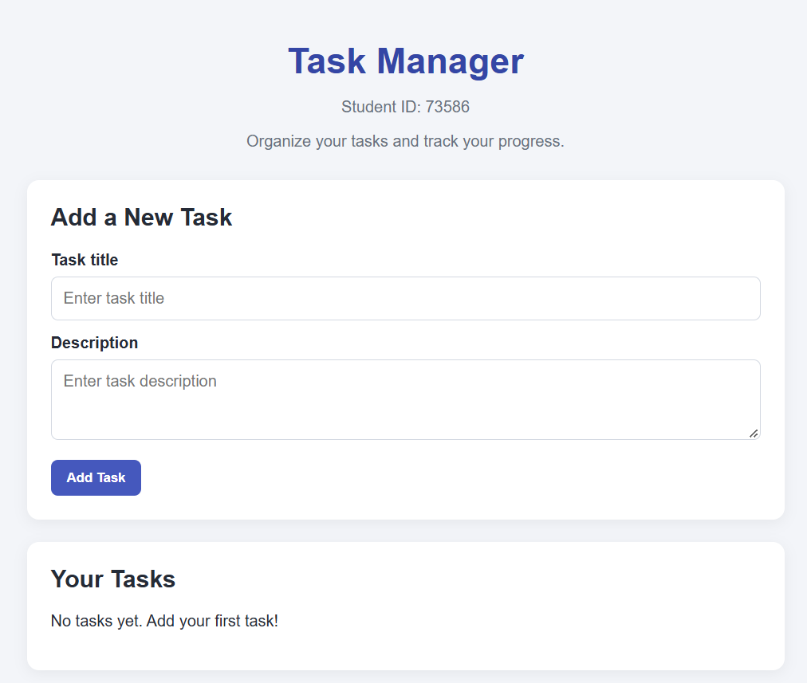
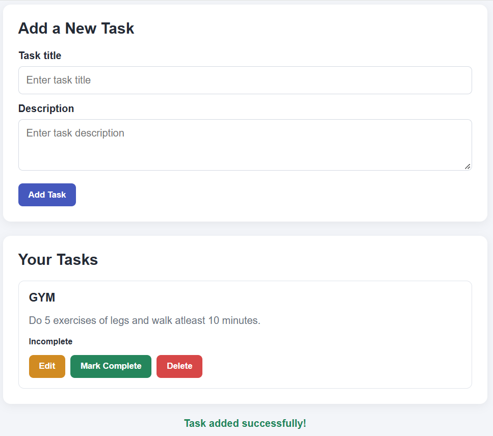
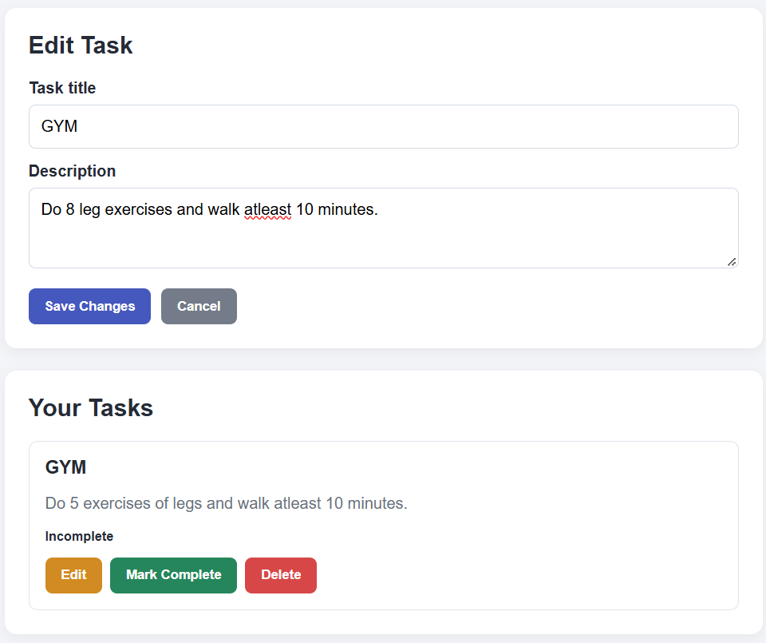
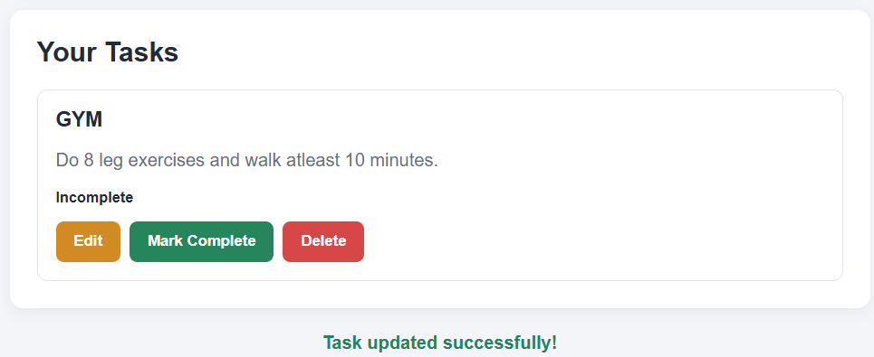
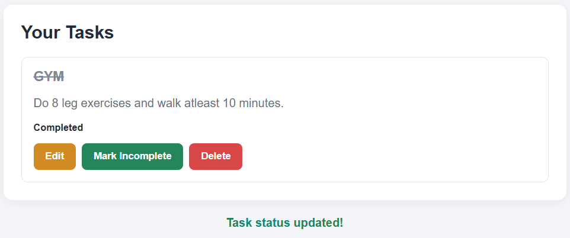
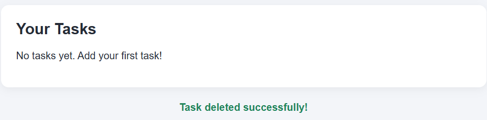

# Task Manager Web Application

**Student ID:** 73586

A simple and responsive Task Manager web application built using HTML, CSS, JavaScript, and Supabase. The application allows users to create, view, edit, complete, and delete tasks. Task data is stored in a Supabase PostgreSQL database, so changes persist when the page is refreshed.

## 1. Project Overview

The purpose of this project is to develop a web-based task management application connected to a backend database through a REST API.

Users can manage their daily tasks through a simple interface. Each task contains a title, an optional description, and a completion status.

## 2. Features

- **Create tasks:** Add new tasks with a title and description.
- **View tasks:** Retrieve and display tasks stored in the database.
- **Edit tasks:** Modify an existing task's title and description.
- **Complete tasks:** Change a task's status between completed and incomplete.
- **Delete tasks:** Remove tasks from the database.
- **Persistent storage:** Store task information in Supabase PostgreSQL.
- **Responsive interface:** Use the application on different screen sizes.

## 3. Technologies Used

| Technology | Purpose |
|---|---|
| HTML5 | Application structure |
| CSS3 | Styling and responsive layout |
| JavaScript | Application logic and API requests |
| Supabase | Backend database and REST API |
| PostgreSQL | Task data storage |
| Git and GitHub | Version control and project hosting |

## 4. Database Structure

The application uses a Supabase PostgreSQL table named `tasks`.

| Column | Data type | Description |
|---|---|---|
| `id` | BIGINT | Unique task identifier and primary key |
| `title` | TEXT | Task title (required) |
| `description` | TEXT | Task description |
| `completed` | BOOLEAN | Indicates whether a task is completed |

Row Level Security (RLS) is enabled, with policies configured for the application's anonymous client operations.

The SQL commands used to create the table, configure RLS, and grant the required permissions are included in `supabase-setup.sql`.

## 5. Application Screenshots

### 5.1 Initial Application Interface

The home page displays the Task Manager heading, student ID, task creation form, and task list.



### 5.2 Adding a Task

Users can enter a task title and description. After submission, the task is saved to the Supabase database and displayed in the task list.



### 5.3 Editing a Task

The Edit button loads the selected task's existing information into the form. Users can modify the information and save the changes.



### 5.4 Updating a Task

After saving the changes, the updated title or description is displayed in the task list.



### 5.5 Completing a Task

Users can mark a task as completed. Its status changes to Completed, and the task title is displayed with a strikethrough.



### 5.6 Deleting a Task

Users can delete tasks that are no longer needed. The deleted task is removed from the task list and database.



## 6. Project Setup

### Prerequisites

- A modern web browser
- Python installed (for running a local development server)
- A Supabase account

### Configuration

1. Create a Supabase project.
2. Execute the SQL statements from `supabase-setup.sql` in the Supabase SQL Editor.
3. Open `config.json`.
4. Configure the Supabase project URL and publishable key.

The configuration file follows this structure:

```json
{
  "supabaseUrl": "YOUR_SUPABASE_PROJECT_URL",
  "supabasePublishableKey": "YOUR_SUPABASE_PUBLISHABLE_KEY",
  "tableName": "tasks"
}
```

Use the Supabase publishable key, not a secret or service-role key.

### Running the Application Locally

1. Clone the repository:

   ```bash
   git clone https://github.com/vistula-team-project-73586/vistula-task-manager.git
   ```

2. Open the project directory:

   ```bash
   cd vistula-task-manager
   ```

3. Start a local development server:

   ```bash
   py -m http.server 8000
   ```

4. Open the following address in your browser:

   `http://localhost:8000`

## 7. Testing

The following operations were tested successfully:

- Creating a new task.
- Displaying saved tasks.
- Editing an existing task.
- Updating task information.
- Marking a task as completed.
- Deleting a task.
- Verifying that task data persists in the Supabase database.

## 8. Repository

**GitHub:** https://github.com/vistula-team-project-73586/vistula-task-manager

---

**Developed by:** Student ID 73586